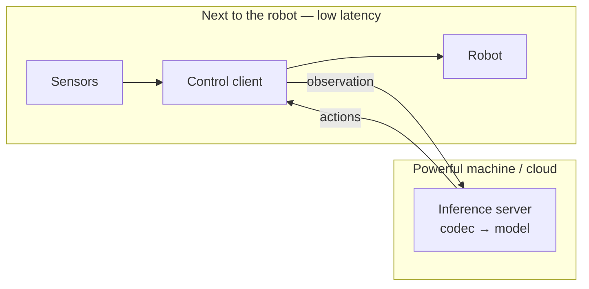
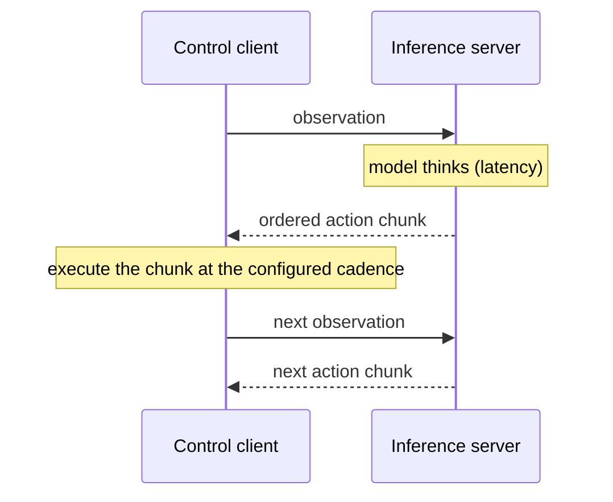

# Connect Your Model

Positronic lets any robot run any policy over one protocol, which a WebSocket or a gRPC wire carries. A trained model runs as a server; the robot — or a simulator — runs a client that streams observations to it and executes the actions it returns.

**What you need:** [uv](https://docs.astral.sh/uv/) and a clone of the repo (`git clone git@github.com:Positronic-Robotics/positronic.git`). Docker is optional — it is only a convenient way to get a vendor model's Python dependencies; the server itself is an ordinary webserver you can also run from a checkout.

For a model environment without Positronic installed, use the
[lightweight model server](../model_server/README.md). It calls the native model in the same process
and declares the full client processing pipeline as data. The deployments below use the legacy
offboard server, which also supports server-side codecs.

## Run the demo

The quickest way to see the whole system is a public ACT checkpoint trained on a simulated cube-stacking task.

Start the server (downloads a ~480 MB checkpoint, then serves on port 8000):

```bash
cd docker && docker compose run --rm --service-ports lerobot-0_3_3-server demo
```

Check it is ready:

```bash
curl -X POST http://localhost:8000/api/v1/keepalive
# {"alive_seconds": null}
```

In a separate terminal, run inference inside the simulation:

```bash
uv run positronic eval run --eval=.sim.positronic.stack_cubes \
  --policy=.remote --policy.address.host=localhost --policy.address.port=8000 \
  --output_dir=~/datasets/demo_run
```

The run is headless. `--output_dir` records every episode (robot state, camera feeds, actions); browse them with:

```bash
uv run positronic-dataset-viewer --dataset.path=~/datasets/demo_run --port=5001
# open http://localhost:5001
```

## How inference works

To control a robot well, the control loop must run on a machine right next to it — every millisecond of delay to the motors matters. But modern policies are large and need a powerful GPU, which usually lives elsewhere: another box on the network, or the cloud. So Positronic splits the system in two:

- an **inference server** that holds the model and, given an observation, returns actions;
- a **control client** that runs next to the robot, reads sensors, sends observations to the server, and drives the motors with what comes back.



The split introduces a delay: the model takes time to think, and the network adds more. **Something has to decide what the robot does during that delay, and how each new batch of predictions blends with the motion already underway.** That decision is yours, and it has to live on the client — the only part fast enough to be in the loop with the robot. That is why there is client-side code at all, and not just a model endpoint.

Two consequences shape the API:

**The server usually returns an ordered action chunk.** A model predicts a short stretch of upcoming motion at once. The client policy decides when to request the next chunk and how to combine predictions with commands already being executed.

**The client scheduler decides when each action runs.** `ChunkedSchedule` dates commands at its configured FPS; `TrajectoryPlayer` emits them when due. It normally finishes each chunk before starting the next and requests the next prediction when the current chunk ends. The model returns ordered actions without timestamps and does not need to account for network or compute delay.



To overlap inference with execution, set `inference_lead`. This requests the next prediction early while the current chunk finishes:

```python
from positronic.policy.processors import ChunkedSchedule, ConstantDuration, TrajectoryPlayer
from positronic.policy.sequential import Sequential

# Request 250 ms before each chunk ends.
Sequential(TrajectoryPlayer(replan_on_error=True), ChunkedSchedule(fps=15, inference_lead=ConstantDuration(0.25)))
```

How the client fills the delay and merges successive predictions is a swappable choice. More advanced strategies — temporal ensembling ([Zhao et al. 2023](https://arxiv.org/abs/2304.13705)) and real-time chunking ([Black et al. 2025](https://arxiv.org/abs/2506.07339)) — blend or replace predictions to stay smooth under latency. They all talk to the same server; only the client logic changes.

## The pieces

A `Policy` is a reusable processor definition. Each episode starts its `run(runtime)`
generator, which receives observations and yields commands plus the next requested
wake-up time. Generator locals hold episode state.

A `Codec` converts observations and actions, and prepares the same features for
training. `Sequential` combines codecs and processors such as `ChunkedSchedule`.
The [Codecs Guide](../positronic/policy/codecs/README.md) lists the available conversions.

A server builds one callable `Model` at launch. A `PolicyDeployment` holds the client
processor stack and an optional server codec, which a session may retune.
`RemotePolicy` opens a session and builds the declared stack around the remote call.

## The wire format

A wire carries [msgpack](https://msgpack.org/) messages with numpy array support (see [Serialization](#serialization)).

### Observation (client → server)

The client sends the full raw robot state as a dict. Keys are flat strings (the dots are literal, not nesting):

| Key | Type | Shape | Description |
|-----|------|-------|-------------|
| `robot_state.ee_pose` | float32 | (7,) | End-effector pose: `x, y, z, qw, qx, qy, qz` (quaternion is **wxyz**, scalar first). A Franka rig reports its grip point `gripper`, on the flange axes ([frame contract](../positronic/drivers/roboarm/README.md)). The server gets this key only when it states its frame ([State the end-effector frame](#state-the-end-effector-frame)) |
| `robot_state.q` | float32 | (7,) | Joint positions (radians) |
| `robot_state.dq` | float32 | (7,) | Joint velocities (radians/s) |
| `robot_state.ee_wrench` | float32 | (6,) | External force and torque on the end effector: `fx, fy, fz` (N), `tx, ty, tz` (N·m). A Franka rig sends the libfranka estimate `K_F_ext_hat_K`, in the libfranka end-effector frame. That frame can differ from the `robot_state.ee_pose` point. libfranka sets all six values to zero when the arm is near or in a singularity ([`robot_state.h`](https://github.com/frankarobotics/libfranka/blob/0.21.3/include/franka/robot_state.h#L341-L349)), and the driver sends them unchanged. An all-zero wrench from a Franka rig, live or recorded, means that libfranka has no estimate. An arm that does not measure the wrench sends no such key |
| `robot_state.status` | int | scalar | The arm's status: `0` available, `1` busy, `3` error. `2` is also accepted and read as available — an arm travelling towards a setpoint still takes commands. The measurements above come on every sample whatever the status; this is what says whether a command you send will reach the arm |
| `grip` | float32 | scalar | Gripper closure in `[0, 1]`: 0 = open, 1 = closed |
| `image.<name>` | uint8 | (H, W, 3) | Camera RGB. Every eval target — PhAIL and each sim — sends `image.exterior` and `image.wrist`, whatever the underlying benchmark calls those cameras, so one codec reads them all; a target with more views adds its own names beside them (the MuJoCo sim adds `image.agent_view`) |
| `task` | str | — | Language instruction for the episode |
| `descriptor` | str | — | Embodiment the observation came from (e.g. `mujoco.franka`); empty string when unset. Lets a multi-embodiment policy adapt to the current robot |

Your server receives every key each step, except a pose whose frame it does not state. An arm that is faulted or busy still reports where it is and says so in `robot_state.status`. The standard stack continues inference and command playback for those observations. Use what your model needs and ignore the rest. Image stream names are configuration-driven, so key off the names your deployment uses rather than assuming fixed ones. The table above is a single-arm rig; a multi-arm one names its state and grip channels per arm.

### Actions (server → client)

`ChunkedSchedule` expects a list of action dicts, including a one-item list for a single action. Other client processors may accept different response shapes.

```python
{"result": [
    {"robot_command": CartesianPosition(pose=...), "target_grip": 1.0},
    {"robot_command": CartesianPosition(pose=...), "target_grip": 1.0},
    ...
]}
```

| Field | Type | Description |
|-------|------|-------------|
| `robot_command` | command object | Control command (see below) |
| `target_grip` | float | Target gripper closure in `[0, 1]`: 0 = open, 1 = closed |

The `robot_command` field says what the arm is asked to do. Build one of the commands in
[`positronic.drivers.roboarm.command`](../positronic/drivers/roboarm/command.py):

| Command | Fields | Description |
|---------|--------|-------------|
| `CartesianPosition` | `pose`: `geom.Transform3D` | Target end-effector pose |
| `JointPosition` | `positions`: float32 (7,) | Target joint angles (radians) |
| `JointDelta` | `velocities`: float32 (7,) | Joint velocity command |
| `CartesianDelta` | `delta`, `frame`: `geom.Transform3D` | Relative motion, composed onto the pose the arm is at when it lands; `frame` is the frame `delta` is expressed in |

Every command also takes an optional `mode`, the control law it asks to execute under:
`PositionControl(stiffness=...)` for a position servo, or `Impedance(kq, kqd, kx, kxd, frame)` for the hybrid
joint/Cartesian law. Omit the mode — the default — and the arm runs its native law. An impedance `frame` is the point
where the Cartesian stiffness acts, measured from the rig's control frame whatever frame the policy speaks; it defaults
to the control frame. The Franka arm refuses a `frame` with a rotation. What a pinned mode does is the
driver's: a simulator runs its own law regardless, and a driver that cannot execute the mode raises.
A server built on positronic sets the mode with the `SetControlMode` codec, composed left of the action
decoder; `codecs.droid_execution` and `codecs.phail_v1_execution` wrap an action codec that way. See
[Control mode](../positronic/policy/codecs/README.md#control-mode) in the Codec Guide.

Which command your model produces is decided by its codec.

An element can also carry the reserved field `end`, with the value `complete` or `give_up`. Ending takes two
declared parts. The `end_command` codec decodes your model's end decision into the `end` command; compose it in
parallel with your action codec, for example `obs & action & EndCommand()`. The `end_on_field` processor sits
outermost in the client stack. When a round plays an element with `end`, it sends the element's other commands,
and the run then ends with this claim. An element that ends still carries the action fields its action codec
reads.

Once your model decides to end, every element of every later answer carries `end` with the same value. The schedule
can drop the element that holds the first `end`: past `horizon_sec`, in a replan after an arm error, in the elements
that `RTCSchedule` skips when a new chunk starts, or when a late round replaces the queue with a new answer. A later
element then carries the end. Until the run stops, the client can play about one more element and make one more call.
The prefix that `RTCSchedule` sends to the model holds `end` like any other command, so a model that cannot read its own `end` back drops it.

`EndOnField` refuses a malformed value when its element plays. When using `PackFields` with
`SplitActionChunk`, include a per-step field named `end` in the output layout.

A rig with more than one arm names every channel after the arm that owns it: observations arrive as
`robot_state.left.ee_pose` and `grip.left`, and an action carries `robot_command.left` alongside
`target_grip.left`. An arm your action omits holds its last command.

### State the end-effector frame

A server that reads `robot_state.ee_pose`, or sends `CartesianPosition` or `CartesianDelta` commands, states the
end-effector frame of each pose. A server that reads no pose and sends joint commands only states no frame.

Put the frames in the server metadata as `ee_frames`, with one entry for each pose. Every client reads them there.
A `PolicyServer` sends `Model.meta()` in its metadata. A protocol v3 `Model` takes its metadata as `metadata=`.

```python
"ee_frames": {
    "robot_state.ee_pose": {"site": "gripper"},  # the pose that the server reads
    "robot_command.pose": {"site": "gripper"},  # the pose of its Cartesian commands
}
```

- `site` is `gripper`, the grip point where the rig reports its pose. Do not name another site.
- With no `offset`, the server gets the pose at the grip point, as the rig reports it.
- The client converts a pose only through `ChangeEEFrame`. An `offset` in the metadata alone converts nothing.
- A model that speaks another frame puts `ChangeEEFrame` in its client stack before `TrajectoryPlayer`, as the
  [example](#models-and-deployments) does. The codec converts each pose and each pose command, and states their
  frames. `cfg.codecs` has presets: `gripper_frame`, `franka_hand_frame` (the FR3 Franka Hand point `F_T_EE`) and
  `droid_frame` (the DROID flange). The [Codecs Guide](../positronic/policy/codecs/README.md#end-effector-frames)
  tells more.
- A protocol v3 stack names the codec
  `component("change_ee_frame", site="gripper", transform=[x, y, z, qw, qx, qy, qz])`.
- `PolicyServer` copies the frames of its client stack into its metadata. A server of another kind puts the same
  frames in its metadata too.

A server that states no frame gets no `robot_state.ee_pose`. A codec of its client stack that reads the pose fails at
the first observation:

```
PolicyCommandError: The client stack that the server declares cannot use the answer or the observation: KeyError('robot_state.ee_pose')
```

A server that reads the pose in its own code gets a `KeyError` there. A pose command with no stated frame fails the
episode with a `PolicyCommandError` that names the channel.

## Debugging with recordings

Pass `--output_dir` on the client to save the full episode as a Positronic dataset, browsable with `positronic-dataset-viewer`.
To play a recorded episode to a server again, see [On a recorded episode](#on-a-recorded-episode).

## Implement your own server

To connect a custom model you implement this protocol. The full low-level spec — endpoints, handshake, status messages — is in the [Offboard README](../positronic/offboard/README.md). A server built on Positronic takes the shortcut below instead.

### Models and deployments

Implement `Model`, then pass a function that builds it and a deployment to `PolicyServer`:

```python
from positronic import keys
from positronic.drivers.roboarm import command
from positronic.drivers.roboarm.models import GRIPPER_SITE, EEFrame
from positronic.policy import keys as policy_keys
from positronic.policy.codecs import ChangeEEFrame
from positronic.offboard.server import PolicyServer
from positronic.offboard.server_utils import warmup
from positronic_model_server.server_wire import ServedHostPort
from positronic.offboard.spec import Model, PolicyDeployment
from positronic_model_server.websocket_wire import WebsocketWire
from positronic.policy.processors import ChunkedSchedule, TrajectoryPlayer
from positronic.policy.sequential import Sequential


class MyModel(Model):
    def __init__(self, weights):
        self.weights = weights

    def __call__(self, obs, *, session_id):
        poses = self.weights.predict(obs[keys.EXTERIOR_IMAGE], obs[keys.EE_POSE])
        return [
            {keys.ROBOT_COMMAND: command.CartesianPosition(pose), keys.TARGET_GRIP: 0.0}
            for pose in poses
        ]

    def meta(self):
        return {'type': 'my_model', policy_keys.CHECKPOINT_ID: 'default'}


def build_my_model():
    # Supply your checkpoint loader, and an observation your model accepts.
    model = MyModel(load_my_weights())
    warmup(model, my_warm_observation())
    return model


# The model reads and commands poses at the grip point, so the client stack states that frame.
deployment = PolicyDeployment(
    local=Sequential(
        ChangeEEFrame(EEFrame(site=GRIPPER_SITE)), TrajectoryPlayer(replan_on_error=True), ChunkedSchedule(fps=15)
    )
)
server = PolicyServer(build_my_model, deployment)
server.serve([WebsocketWire(ServedHostPort('0.0.0.0', 8000))])
```

Return a full ordered chunk, with no timestamp entries. The client scheduler owns
cadence and the execution horizon. Add a server codec with `codec=your_codec` if
the model takes encoded inputs and returns model-native outputs. Client codecs
belong in `local`, where they can mix with processors. For example,
`TransformImages(224, 224, mode=ResizeMode.BOUND)` before the remote call limits upload volume.
The client JPEG-encodes each frame before it sends it. Set `compress_images=False` on the
deployment to receive raw frames.
The client sets the JPEG quality with `--policy.jpeg_quality`, 90 by default.

The server builds the model once, off the event loop, before any wire binds. A
slow download or subprocess startup writes its progress to the server log. The
model owns those resources and releases them in `close()`. See the OpenPI and
GR00T adapters for examples.

The builder must warm the model before it returns: `warmup` runs one inference, so
the first-call cost of a backend is paid before the server serves. A client reads
any keepalive answer as ready, and a cold model makes its first inference slow.

The server supplies `session_id` on every call. Several sessions can be open at the
same time: a competition run opens up to 12. The server calls the model for one
inference at a time. A stateless model may ignore `session_id`. A stateful model
keeps one state for each session over one copy of the weights, as the LeRobot model
in [`positronic/vendors/lerobot/policy.py`](../positronic/vendors/lerobot/policy.py) does.
Implement `end_session(session_id)` to release that episode's state. It runs after
outstanding inference finishes, both on explicit session end and on disconnect.
The model remains loaded for subsequent episodes.

Test the deployment as [Test your server](#test-your-server) tells.

### Serialization

Every message is msgpack. Numpy arrays use a custom extension:

```python
# numpy array -> msgpack
{
    b"__ndarray__": True,
    b"data": array.tobytes(),   # raw bytes
    b"dtype": str(array.dtype), # e.g. "<f4"
    b"shape": array.shape       # tuple
}
```

An image frame travels as JPEG unless the deployment sets `compress_images=False`. One envelope
carries one `(H, W, 3)` frame or a `(T, H, W, 3)` stack:

```python
# uint8 image or image stack -> msgpack
{
    b"__jpeg__": True,
    b"frames": [jpeg_bytes, ...],  # one JPEG per frame
    b"ndim": 3,                    # 3 for one frame, 4 for a stack
}
```

`positronic.offboard.protocol` provides `serialise()` / `deserialise()`, which handle both
envelopes and the robot commands. `deserialise()` decodes each JPEG frame back to a uint8 array. A
server that does not use it decodes the frames itself, or sets `compress_images=False`.

The session handshake and inference envelopes are defined in the
[Offboard Protocol](../positronic/offboard/README.md). Use `PolicyServer` to handle
session IDs, model loading, cleanup, and errors.

A protocol v2 server written in another stack cannot import that module. Answer with the command as the plain
mapping `positronic.drivers.roboarm.command.to_wire` produces — `{"type": "cartesian_pos", "pose": [...]}`
— under the `robot_command` key, and the client types it on arrival.

The [lightweight model server](../model_server/README.md) speaks protocol v3, and the client does not type a
mapping that it answers. The client stack that the session declares turns the model's output into commands.
This session answers joint targets, and the stack passes the observation through to the model:

```python
from positronic_model_server.spec import component, parallel, sequence

description = sequence(
    component("trajectory_player", replan_on_error=True),
    component("inference_schedule", fps=15.0, request_timing={"reference": "before_end"},
              merge={"start": "after_previous", "horizon_sec": None}, latency_estimate=0.0),
    parallel(
        component("rename_observation_fields", mapping={}),
        component("joint_position_action", joints_key="robot_command", grip_key="target_grip"),
    ),
)
# Session.infer returns [{"robot_command": [7 joint positions], "target_grip": grip}, ...]
```

The [Codecs Guide](../positronic/policy/codecs/README.md) lists the other action codecs, such as
`bimanual_joints_action` for two arms.

The client refuses a mapping at `robot_command` with a `PolicyCommandError`.

## Test your server

Test a server in a simulator first, then on a recorded robot episode. Both tests run the client that runs on a rig.

### In a simulator

Run an eval against the server:

```bash
uv run positronic eval run --eval=.sim.positronic.stack_cubes \
  --policy=.remote --policy.address.host=localhost --policy.address.port=8000 \
  --output_dir=~/evals/stack_cubes
```

The MuJoCo scene sends `image.exterior`, `image.wrist` and `image.agent_view`. A server that reads
`image.exterior_2`, such as a `droid_3cam` pipeline, answers each of its observations with an error. MolmoSpaces sends
both exterior views. For such a server, run `molmo.franka_pick_mini_smoke` as
[Score a policy on MolmoSpaces on your machine](local-molmospaces-eval.md) tells. Browse the recorded episodes with
`uv run positronic-dataset-viewer --dataset.path=~/evals/stack_cubes`.

### On a recorded episode

`positronic.offboard.replay_episode` plays the observations of a recorded episode to the server. The client stack that
the server declares runs as on a rig. The clock of the episode stops during each call. Each command prints beside the
command that the episode recorded at the same time.

A public episode is at `s3://positronic-public/datasets/droid-3cam-pi05/v1/`. In it, the π0.5 DROID policy of the
`positro/pi05-droid` image takes a marker out of a mug on a Franka DROID rig, in 90 s. The episode records
`image.exterior`, `image.exterior_2` and `image.wrist` at 1280 × 720, the arm state, the grip and the policy commands.

Make one call on the observation 10 s into the episode:

```bash
uv run python -m positronic.offboard.replay_episode \
  --dataset.path=s3://PUBLIC@positronic-public/datasets/droid-3cam-pi05/v1/ \
  --policy.address.host=localhost --policy.address.port=8000 \
  --start_sec=10 --calls=1
```

`PUBLIC@` reads the bucket with no credentials. The command prints each command of the answer as the client plays it.
This output comes from a server that holds the arm where it is:

```
Episode of 89.9 s on harness.world: 'Take the marker out of the mug and put it on the table'
Observations sent: ['grip', 'image.exterior', 'image.exterior_2', 'image.wrist', 'robot_state.dq', 'robot_state.ee_wrench', 'robot_state.q', 'robot_state.status']
  10.000 s  call 1 answered in 79 ms
  10.000 s  robot_command = JointPosition(positions=array([-0.011,  0.497, -0.035, -1.583,  0.104,  1.535,  0.156], dtype=float32), mode=None)
  10.000 s  target_grip = 0.7372549019607844
  10.000 s  recorded robot_command.joints = [-0.011  0.504 -0.034 -1.575  0.106  1.526  0.175]
  10.000 s  recorded target_grip = 1.0
  10.067 s  robot_command = JointPosition(positions=array([-0.011,  0.497, -0.035, -1.583,  0.104,  1.535,  0.156], dtype=float32), mode=None)
  ...
1 calls answered
```

- Remove `--start_sec` and `--calls` to play the whole episode. `--end_sec` stops the play at that time.
- `--dataset.path` also takes a local directory, such as the `--output_dir` of an eval. `--episode` selects an
  episode of a dataset that holds more than one.
- The server gets `robot_state.ee_pose` only when it states the frame of that pose, at the site the recording
  reports it at, as on a rig ([State the end-effector frame](#state-the-end-effector-frame)).
- Each observation comes from the recording, whatever the server commands.
- The recorded commands are the commands of π0.5. Compare the type, the size and the range of your commands with them.
- A step that names a channel the episode records no command on, or a pose command whose frame the server does not
  state, stops the play with a `PolicyCommandError`. A rig refuses the same step.

## Expose your server

Positronic can run an eval against a server on your machine ([Four ways to start](evaluation.md#four-ways-to-start)).
The platform then dials the server over the internet. It needs only this:

- A public host name or a public IP address.
- A port that the platform can reach from the internet.

An open server on the plain `websocket` or `grpc` wire is enough. Tailscale and other private networks are not
offered: the platform dials only a public address.

The endpoint entry of the eval plan names the wire and the address
([Eval plans](../client/README.md#eval-plans)).

Two options limit who can use the server:

- **A bearer token.** Start the server with the token in `AUTH_TOKEN`
  ([Authentication](../positronic/offboard/README.md#authentication)). The endpoint entry then names the file that
  holds the token, in `auth_token_file`. The server refuses a request without the token.
- **A TLS wire.** Put a TLS edge in front of the server, such as a reverse proxy with a certificate for the host name,
  and name `websocket_tls` or `grpc_tls` ([Wires](../positronic/offboard/README.md#wires)).

On a wire without TLS, the token travels in clear. Use the two options together.

A server on Modal works in two forms:

- **A Modal web endpoint** (`@modal.asgi_app` or `@modal.web_server`) at its `*.modal.run` URL takes `websocket_tls`
  on port 443. It can run open. With Modal proxy auth on, the token file holds the proxy token as
  `<token-id>.<token-secret>`, which Modal takes as a bearer token
  ([Proxy auth](https://modal.com/docs/guide/webhook-proxy-auth)).
- **A Modal Server with sticky sessions** (`modal_websocket_tls`, a `*.modal.direct` URL) works from a plan only when
  it lets a session start with no authentication (`@app.server(unauthenticated=True)`). A plan refuses a token on
  that wire ([Eval plans](../client/README.md#eval-plans)).

Check the endpoint from a machine outside your network:

```bash
curl -X POST http://policy.example.com:8000/api/v1/keepalive
```

An answer shows that the server is reachable. A server with a token answers `401` here. Then play the public episode
to the endpoint:

```bash
uv run python -m positronic.offboard.replay_episode \
  --dataset.path=s3://PUBLIC@positronic-public/datasets/droid-3cam-pi05/v1/ \
  --policy.address.host=policy.example.com --policy.address.port=8000 \
  --start_sec=10 --calls=1
```

For a server with a token and TLS, put the token in `AUTH_TOKEN` and add
`--policy=@positronic.cfg.policy.authed_remote --policy.wire=websocket_tls --policy.address.port=443`.

## See Also

- [Offboard Protocol](../positronic/offboard/README.md) – full Protocol v1 specification
- [Codecs Guide](../positronic/policy/codecs/README.md) – reusable codecs and vendor recipes
- [Inference Guide](inference.md) – local and remote inference patterns
- [Training Workflow](training-workflow.md) – training with public datasets
