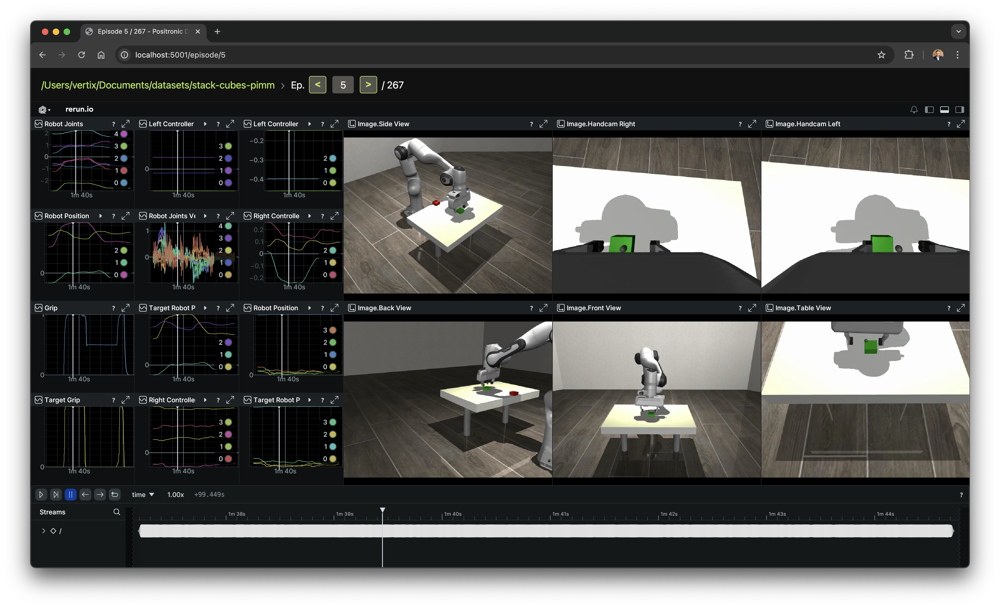

# Data Collection Guide

A person records demonstrations through the teleop service, `positronic teleop`, and an ordinary `eval run`. For the
run, the person is the policy `cfg.policy.teleop`. So a demonstration records the same data as a model trial: an
immutable raw dataset that [codecs](../positronic/policy/codecs/README.md) project to any model format.

The [Teleoperation Guide](../positronic/teleop/README.md) gives the commands, the devices and the controls:
- [Collect demonstrations in MuJoCo](../positronic/teleop/README.md#collect-demonstrations-in-mujoco)
- [Collect demonstrations in MolmoSpaces](../positronic/teleop/README.md#collect-demonstrations-in-molmospaces)
- [Collect demonstrations on the bimanual YAM in ABC](../positronic/teleop/README.md#collect-demonstrations-on-the-bimanual-yam-in-abc)

## Meta Quest

Open Oculus Browser, and go to `https://<host-ip>:5005/`. The browser shows a "Dangerous connection" warning, because
the certificate is self-signed. Click Advanced → Proceed. Click "Enter AR" and approve the permissions.

## Phones

If "Enter AR" does not appear, try a different browser, or set `--webxr.use_https=True` or `False`. For jittery
tracking, use good light and hold the phone steady. If the phone cannot reach the service, open port 5005 in the
firewall.

## Hardware

A Franka Panda needs FCI, a gripper and cameras. Install the extras with `uv sync --locked --extra hardware --extra
franka` (Linux only). The `franka` extra builds against libfranka, which the machine must already carry: 0.15.3 for a
robot system version from 5.7.2 up to, not including, 5.9.0, and 0.21.3 for 5.9.0 and later. Configure the network
connection and the udev rules (see [Drivers](../positronic/drivers/)).

Add a hardware config in `positronic/cfg/hardware/`.

**S3 support:** Positronic uses [pos3](https://github.com/Positronic-Robotics/pos3) for S3. `--output_dir` takes an
`s3://` path too. The data is cached locally and synced.

## Best practices

Record calibration runs first, and review them in the dataset viewer. Collect 50+ demonstrations for a single task
(minimum 30; a multi-task set needs 100-500+). Randomize the object positions, vary the approach angles, keep the
episodes short (10-30 s), and show successful and near-failure cases (not catastrophic failures).

## Reviewing Data

Launch the viewer:
```bash
uv run positronic-dataset-viewer \
    --dataset.path=~/datasets/my_task \
    --port=5001
```

Open `http://localhost:5001` to browse the episodes, view the camera feeds and check the timestamps. Delete a
low-quality episode by hand: `rm -rf ~/datasets/my_task/000000000000/000000000042/`.



## Next Steps

After collection: **Review** the data in the viewer → **Curate** by removing failures → **Convert** with codecs
([Training Workflow](training-workflow.md)) → **Train** a policy ([Model Selection](model-selection.md)) →
**Evaluate** ([Inference Guide](inference.md)).

## See Also

- [Teleoperation Guide](../positronic/teleop/README.md) – the teleop service, the devices and the controls
- [Training Workflow](training-workflow.md) – converting and training
- [Codecs Guide](../positronic/policy/codecs/README.md) – format projection
- [Inference Guide](inference.md) – policy deployment
- [Dataset Library](../positronic/dataset/README.md) – raw storage
- [Drivers](../positronic/drivers/) – hardware integration
